# ChoiHub · 올인원 그룹웨어

근태, 일정, 전자결재, 공지사항, 게시판, 조직도 등 회사 업무를 한 곳에서 관리하는 그룹웨어입니다.

여러 회사가 함께 쓰는 멀티 테넌트 구조로, 운영자가 회사 계정을 발급하면 각 회사의 매니저가 구성원을 추가하고 회사 안에서 업무를 운영합니다.

---

## 배포 주소

| 구분 | URL |
|---|---|
| 서비스 | https://choihub.vercel.app |
| API 서버 | https://choihub-backend.vercel.app/api |

### 체험하기

로그인 화면의 **매니저로 로그인** / **직원으로 로그인** 버튼을 누르면 데모 계정으로 바로 로그인됩니다. 역할에 따라 메뉴와 권한이 어떻게 달라지는지 확인할 수 있습니다.

| 버튼 | 계정 | 소속 |
|---|---|---|
| 매니저로 로그인 | `admin@testcompany.example` | 경영지원본부 |
| 직원으로 로그인 | `user@testcompany.example` | 프론트엔드팀 |

> 무료 플랜의 서버리스 환경에서 동작하므로, 한동안 요청이 없다가 처음 접속하면 응답이 몇 초 늦을 수 있습니다.

---

## 프로젝트 구성

### 전체 구조

```
브라우저 ──▶ Front-end (Next.js, Vercel)
                │  axios · Authorization: Bearer <access token>
                ▼
          Back-end (NestJS, Vercel Functions)
                │  TypeORM
                ▼
          PostgreSQL (Supabase)
```

### Front-end

- Language & Framework: TypeScript, React 19, Next.js 16 (App Router)
- Style: Emotion (`@emotion/styled`), lucide-react (아이콘)
- State: zustand (로그인 세션), TanStack Query (서버 데이터 캐싱)
- Form: react-hook-form + zod
- HTTP: axios
- Infra: Vercel

### Back-end

- Language & Framework: TypeScript, NestJS
- DB: PostgreSQL (Supabase), TypeORM (마이그레이션으로 스키마 관리)
- 인증: JWT access token + refresh token(1회용, 재발급 시 교체)
- Infra: Vercel (서버리스 함수)

### 폴더 구조

```
app/          라우트 (App Router)
  admin/        운영 콘솔 (운영자 로그인, 회사 관리)
  dashboard/    그룹웨어 화면 (로그인한 구성원)
  login/        구성원 로그인
components/   화면별 컴포넌트, 공통 UI(components/ui)
apis/         axios 인스턴스(defaultInstance.ts)와 도메인별 API 호출(services/)
queries/      TanStack Query 훅, 쿼리 키, 인증 훅
lib/          zustand 스토어, zod 스키마, 라벨·날짜 등 유틸
types/        도메인별 요청·응답 타입
styles/       테마, 반응형 미디어 쿼리
proxy.ts      로그인한 구성원이 / 에 들어오면 /dashboard로 이동
```

### 실행 방법

```bash
npm install
npm run dev
```

API 주소는 환경변수 `NEXT_PUBLIC_API_BASE_URL`로 지정합니다. 지정하지 않으면 `http://localhost:4000/api`를 사용합니다.

---

## 주요 기능

### 역할과 권한

| 역할 | 설명 |
|---|---|
| 운영자 | 운영 콘솔에서 회사(테넌트)를 등록하고 매니저 계정을 발급·관리 |
| 매니저 | 회사 안에서 구성원·부서·회사정보·결재 양식·회의실을 관리하고, 휴가와 결재를 승인 |
| 직원 | 근태 기록, 휴가 신청, 결재 상신, 일정·업무·게시판 등 일상 업무 |

### 인증 흐름

- 로그인하면 access token과 refresh token을 받아 localStorage에 보관하고, 사용자 정보는 `GET /auth/me`로 조회합니다.
- API 요청이 401을 받으면 refresh token으로 토큰을 한 번 재발급한 뒤 원래 요청을 다시 보냅니다. 동시에 여러 요청이 401을 받아도 재발급은 한 번만 합니다.
- 재발급에 실패하면 로그아웃하고 로그인 화면으로 이동합니다. 여러 탭의 세션은 서로 동기화됩니다.
- 처음 발급된 계정은 첫 로그인 때 비밀번호를 바꿔야 업무 화면을 쓸 수 있습니다.
- 이용이 정지된 회사의 구성원은 로그인해도 정지 안내 화면만 볼 수 있습니다.

---

## 화면 구성

<!-- 스크린샷은 public/images/README/ 아래에 두고  형식으로 넣으면 됩니다. -->

### 1. 서비스 소개

> URL : `/`

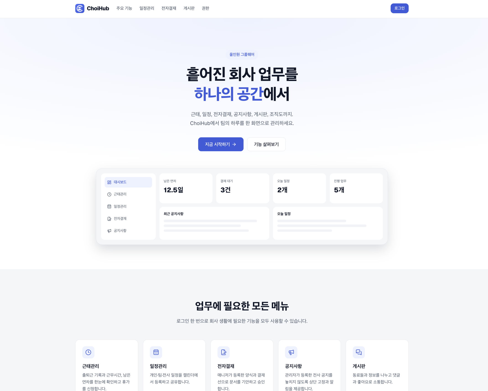

주요 기능 소개, 일정관리·전자결재·게시판 미리보기, 역할별 권한 안내로 구성된 소개 화면입니다.

로그인한 구성원이 들어오면 화면을 그리기 전에 서버(`proxy.ts`)에서 대시보드로 이동시킵니다.

### 2. 로그인

> URL : `/login`

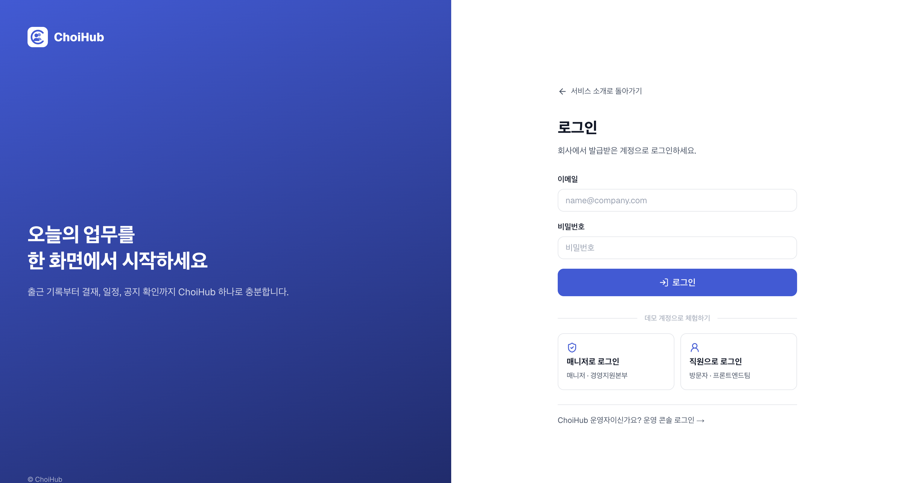

이메일과 비밀번호로 로그인합니다. 데모 계정 버튼을 누르면 입력 없이 바로 로그인할 수 있습니다.

하단의 링크로 운영 콘솔 로그인 화면으로 이동할 수 있습니다.

### 3. 대시보드

> URL : `/dashboard`

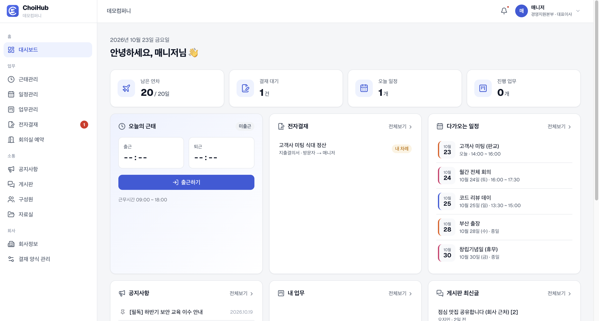

오늘 해야 할 일을 한 화면에서 확인합니다.

- 남은 연차, 결재 대기, 오늘 일정, 진행 중인 업무 수
- 출근하기 / 퇴근하기 버튼과 오늘 근무 시간
- 내 차례인 결재 문서, 다가오는 일정, 최근 공지사항, 내 업무, 게시판 최신글, 오늘 회의실 예약
- 구성원 근무 상태(근무중·재택·외근·휴가) 현황

상단바의 알림에서는 결재 요청, 오늘 일정, 최근 3일 안에 올라온 공지를 모아 볼 수 있습니다.

### 4. 근태관리

> URL : `/dashboard/attendance`

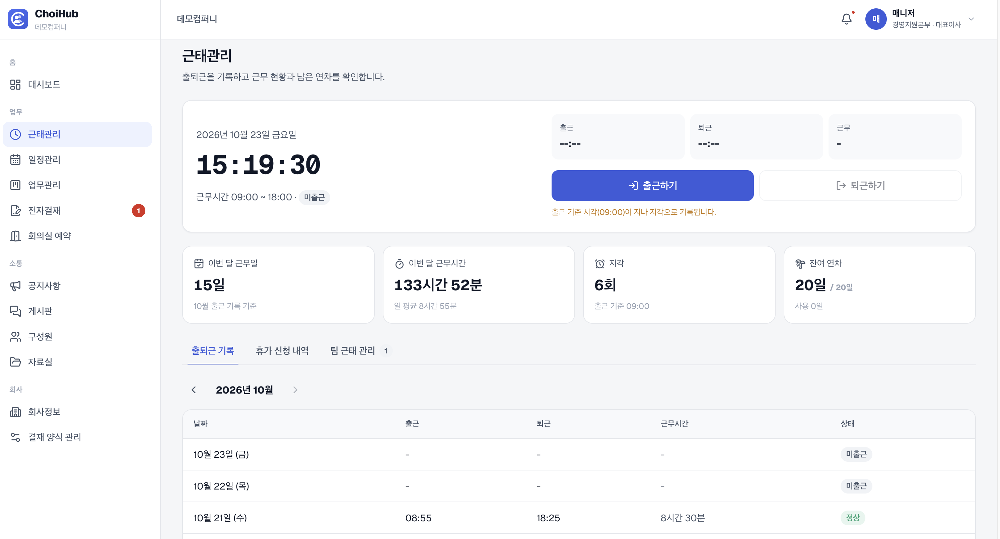

- **출퇴근:** 실시간 시계와 출근·퇴근 버튼을 제공합니다. 회사의 출근 기준 시각이 지나면 지각으로 기록된다는 안내가 표시됩니다.
- **월별 요약:** 이번 달 근무일, 근무시간(일 평균), 지각 횟수, 잔여 연차를 보여줍니다.
- **출퇴근 기록:** 월 단위로 날짜별 출근·퇴근 시각, 근무시간, 상태(정상·지각·조퇴 등)를 확인합니다.
- **휴가 신청:** 연차, 오전·오후 반차, 병가, 경조휴가를 신청합니다. 신청 전에 차감될 일수와 남은 연차를 미리 보여주고, 주말은 일수에서 제외합니다.
  - 직원의 휴가는 소속 부서의 매니저가 승인하고, 매니저 본인의 휴가는 신청 즉시 승인됩니다.
  - 승인 전에는 신청을 취소할 수 있습니다.
- **팀 근태 관리 (매니저):** 담당 부서 구성원의 휴가를 승인·반려하고, 오늘 출근·지각·휴가·미출근 현황을 확인합니다.

### 5. 일정관리

> URL : `/dashboard/schedule`

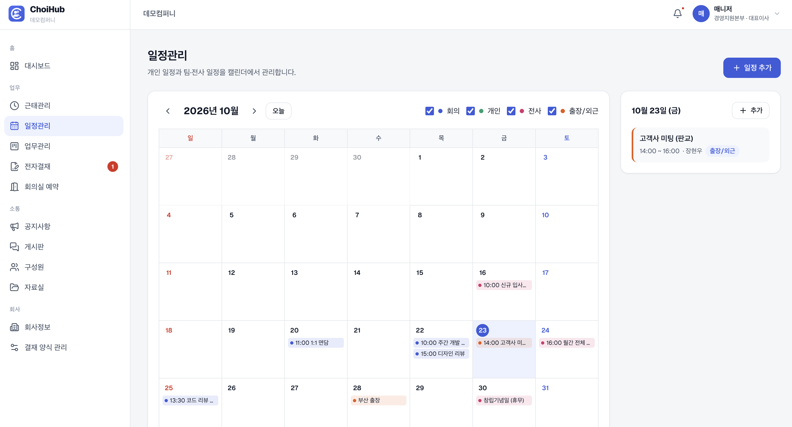

- 월간 캘린더에서 날짜를 선택하면 그날의 일정 목록이 옆에 표시됩니다.
- 분류(회의, 개인, 전사, 출장/외근)별로 색을 구분하고, 체크박스로 걸러 볼 수 있습니다.
- 일정을 추가할 때 종일 여부와 전 직원 공개 여부를 정할 수 있습니다. 전사 일정은 매니저만 등록할 수 있고 항상 공개됩니다.
- 내 일정과 공개된 일정만 보이며, 일정 삭제는 작성자와 매니저가 할 수 있습니다.

### 6. 업무관리

> URL : `/dashboard/tasks`

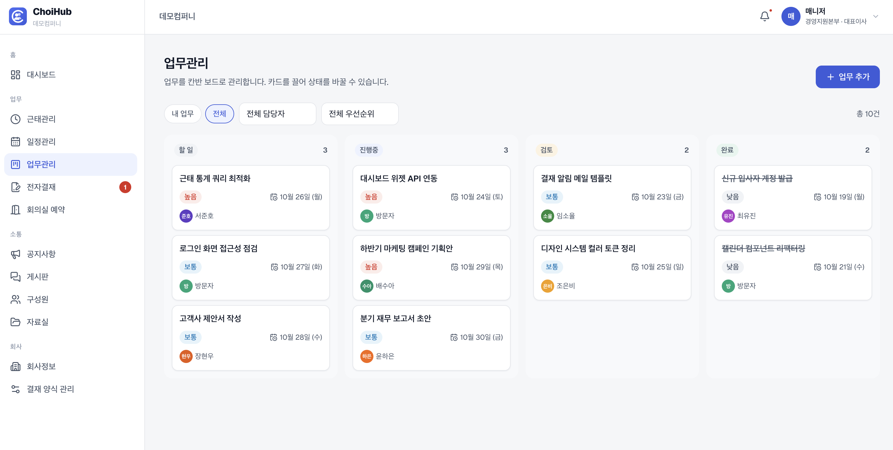

- 할 일, 진행중, 검토, 완료로 나뉜 칸반 보드에서 카드를 끌어 상태를 바꿉니다. 화면을 먼저 바꾸고, 서버 요청이 실패하면 원래대로 되돌립니다.
- 내 업무 / 전체, 담당자, 우선순위로 걸러 볼 수 있고, 마감일이 지난 업무는 지연으로 표시합니다.
- 업무는 작성자, 담당자, 매니저만 수정·이동·삭제할 수 있고, 그 외 구성원에게는 읽기 전용으로 보입니다.

### 7. 전자결재

> URL : `/dashboard/approval`

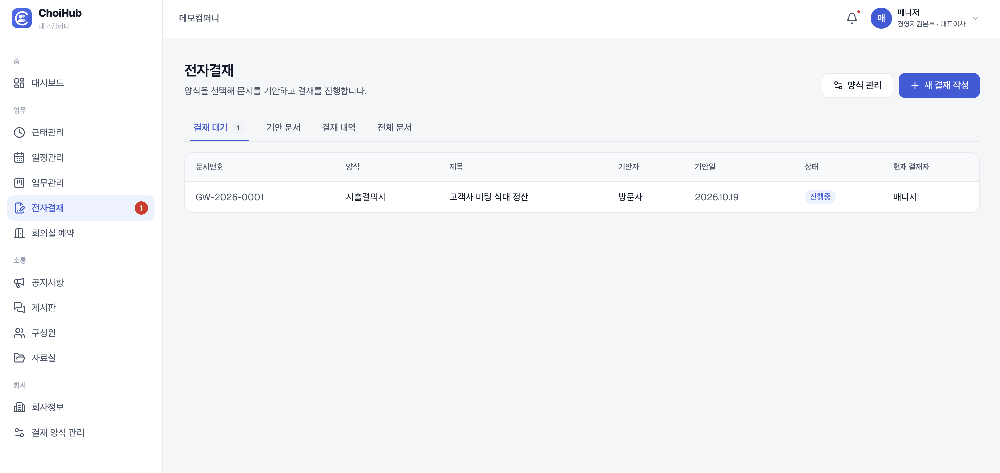

- 결재 대기, 기안 문서, 결재 내역 탭으로 문서를 나눠 보고, 매니저는 전체 문서도 볼 수 있습니다.
- **결재 작성:** 사용 중인 양식을 고르면 양식에 정의된 입력 항목과 결재선이 자동으로 적용됩니다. 상신하면 서버에서 문서번호가 매겨집니다.
- **결재 상세:** 기안부터 결재 단계까지 도장 형태의 결재선과 처리 이력을 보여줍니다. 내 차례인 문서는 승인 또는 반려할 수 있고, 반려할 때는 의견을 반드시 남겨야 합니다.
- **회수:** 기안자는 아무도 처리하지 않은 진행 중 문서를 회수할 수 있습니다.

### 8. 결재 양식 관리 (매니저)

> URL : `/dashboard/approval/forms`

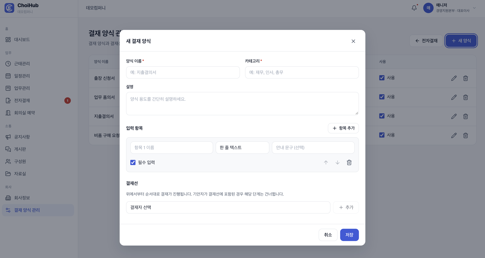

- 양식의 이름, 카테고리, 설명을 정하고 입력 항목(종류, 필수 여부, 안내 문구)을 추가하고 순서를 바꿀 수 있습니다.
- 결재선에 구성원을 넣고 순서를 정합니다. 기안자가 결재선에 포함돼 있으면 그 단계는 건너뜁니다.
- 양식을 수정해도 이미 상신된 문서에는 영향이 없습니다. 문서가 있는 양식은 삭제 대신 사용 중지할 수 있습니다.

### 9. 회의실 예약

> URL : `/dashboard/reservations`

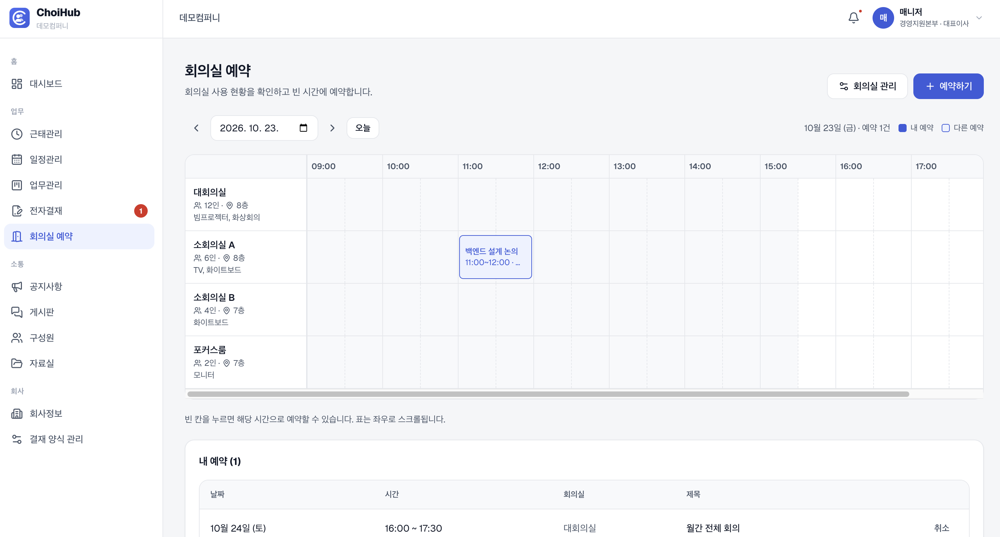

- 날짜별로 회의실마다 09:00~19:00를 30분 단위 타임라인으로 보여줍니다. 빈 칸을 누르면 바로 예약할 수 있습니다.
- 겹치는 예약, 사용 중지된 회의실, 지난 시간은 서버에서 막습니다.
- 내 예약 목록에서 앞으로의 예약을 확인하고 취소할 수 있습니다.

**회의실 관리 (매니저)** — `/dashboard/reservations/rooms`

- 회의실의 이름, 수용 인원, 위치, 장비를 등록하고 표시 순서를 바꿉니다.
- 사용 중지 사유를 남기면 예약 화면에 표시됩니다. 앞으로의 예약이 있는 회의실은 삭제 대신 사용 중지할 수 있습니다.

### 10. 공지사항

> URL : `/dashboard/notices`

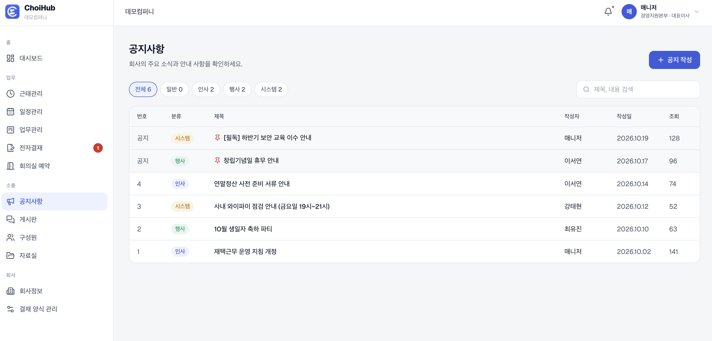

- 분류(일반, 인사, 행사, 시스템)와 검색어로 공지를 찾고, 페이지 단위로 봅니다. 고정된 공지는 목록 맨 위에 표시됩니다.
- 상세 화면에서 조회수와 이전·다음 글을 확인합니다.
- 공지 작성·수정·삭제와 상단 고정은 매니저만 할 수 있습니다.

### 11. 게시판

> URL : `/dashboard/board`

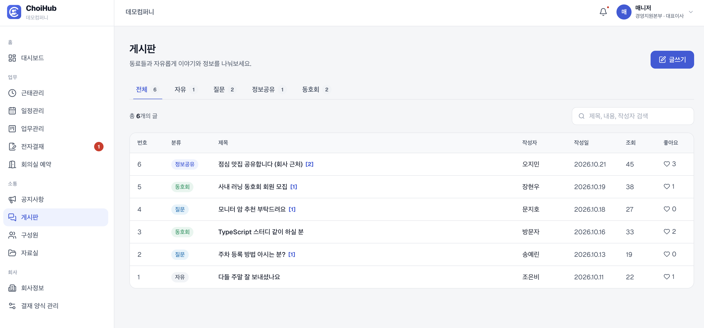

- 분류(자유, 질문, 정보공유, 동호회)와 검색어(제목, 내용, 작성자)로 글을 찾고, 페이지 단위로 봅니다.
- 상세 화면에서 좋아요, 댓글 작성·삭제, 이전·다음 글 이동을 할 수 있습니다.
- 글 수정은 작성자만, 삭제는 작성자와 매니저가 할 수 있습니다.

### 12. 구성원

> URL : `/dashboard/members`

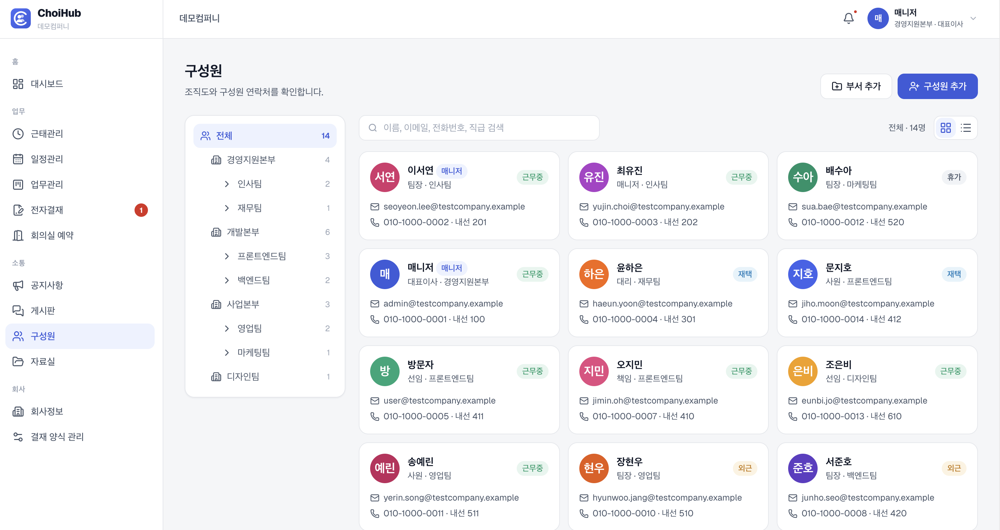

- 부서 트리로 조직도를 보고, 부서를 고르면 하위 부서 구성원까지 함께 보여줍니다.
- 이름, 이메일, 연락처, 직급, 내선번호로 검색하고 카드 보기 / 표 보기를 전환합니다.
- **매니저:** 부서를 추가하고 구성원을 추가·수정·삭제합니다.
  - 새 구성원에게는 초기 비밀번호가 자동 발급되어 한 번만 표시되고, 첫 로그인 때 비밀번호를 바꿔야 합니다.
  - 삭제된 구성원은 로그인할 수 없지만, 작성한 문서와 글은 "삭제된 구성원"으로 남습니다.

### 13. 자료실

> URL : `/dashboard/archive`

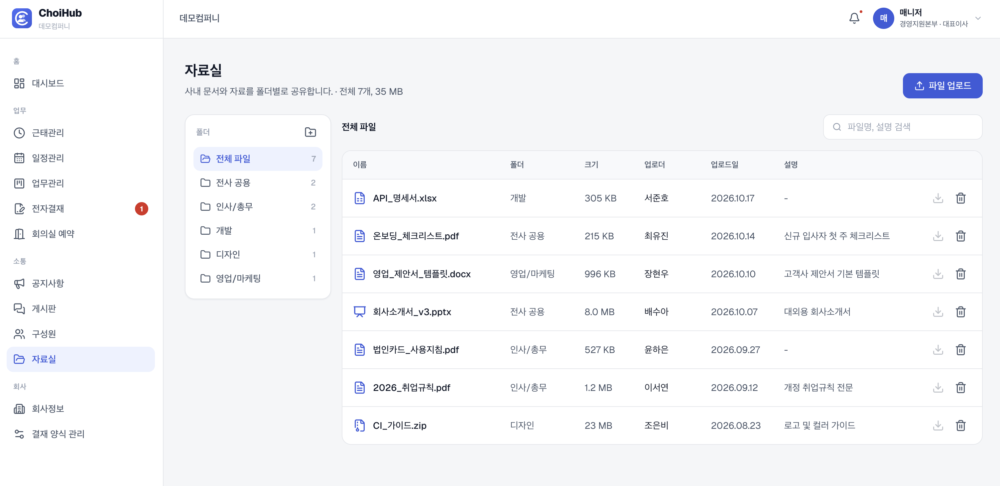

- 폴더별로 파일을 보고, 파일명과 설명으로 검색합니다. 모든 구성원이 파일을 내려받을 수 있습니다.
- 파일 업로드와 폴더 추가는 매니저만 할 수 있고, 파일 삭제는 업로드한 사람과 매니저가 할 수 있습니다.
- 일정 크기 이하의 파일만 내용을 저장하고, 그보다 큰 파일은 정보만 등록되어 내려받을 수 없습니다.

### 14. 회사정보

> URL : `/dashboard/company`

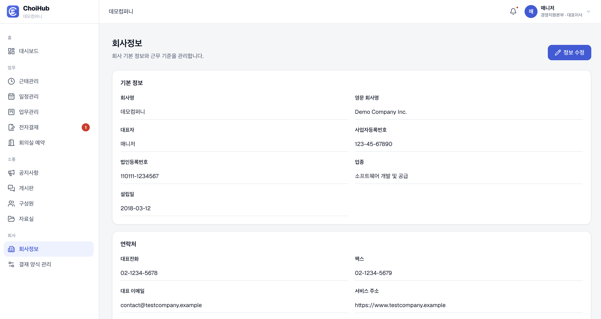

- 회사의 기본 정보, 연락처, 근무 설정(출근·퇴근 시각, 기본 연차일수)을 보여줍니다.
- 출근 시각은 지각 판정 기준이 되고, 기본 연차일수는 새 구성원에게 적용됩니다.
- 수정은 매니저만 할 수 있습니다.

### 15. 내 정보

> URL : `/dashboard/profile`

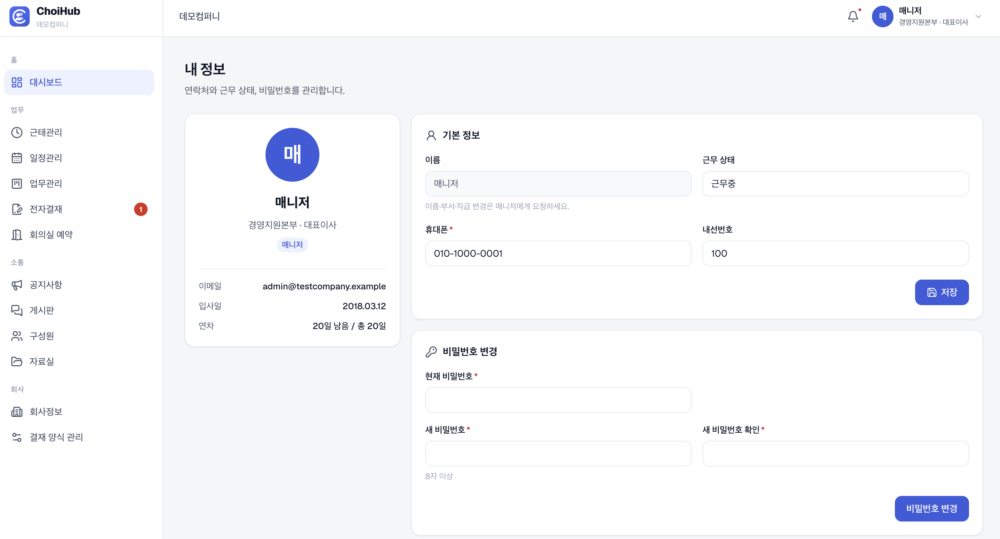

- 내 소속, 직급, 역할, 입사일, 남은 연차를 확인합니다.
- 근무 상태(근무중, 재택, 외근, 휴가), 휴대폰, 내선번호를 직접 바꿀 수 있습니다. 이름, 부서, 직급은 매니저에게 요청해야 합니다.
- 현재 비밀번호를 확인한 뒤 새 비밀번호로 바꿀 수 있습니다.

### 16. 운영 콘솔

> URL : `/admin`

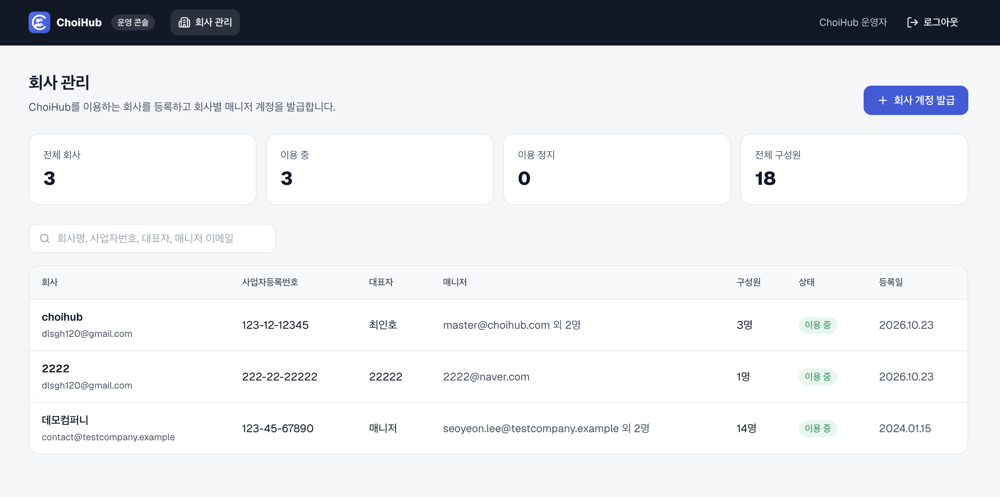

운영자 전용 화면으로, 그룹웨어를 사용할 회사를 관리합니다.

- **회사 관리:** 전체·이용 중·이용 정지 회사 수와 전체 구성원 수를 보여주고, 회사명, 사업자등록번호, 대표자, 매니저 이메일로 검색합니다.
- **회사 계정 발급** (`/admin/companies/new`): 회사 정보와 첫 매니저 계정을 입력하면, 로그인 주소·아이디·초기 비밀번호를 한 번만 보여줍니다. 기본 부서(경영지원)와 기본 결재 양식 2개가 함께 만들어집니다.
- **회사 상세** (`/admin/companies/[id]`)
  - 회사의 이용을 정지하거나 재개합니다. 정지하면 데이터는 그대로 두고 해당 회사 구성원의 로그인만 막습니다.
  - 매니저를 추가하거나 매니저의 비밀번호를 초기화하고, 회사 정보를 수정합니다.
